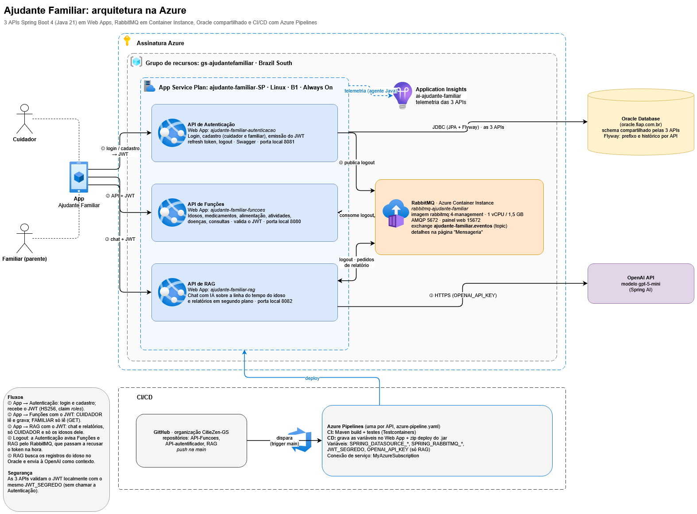
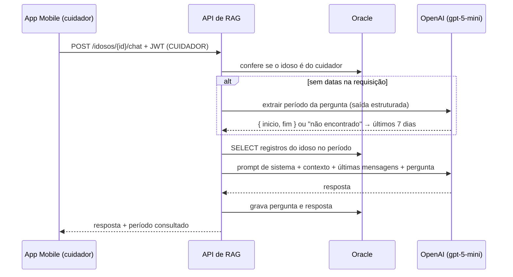
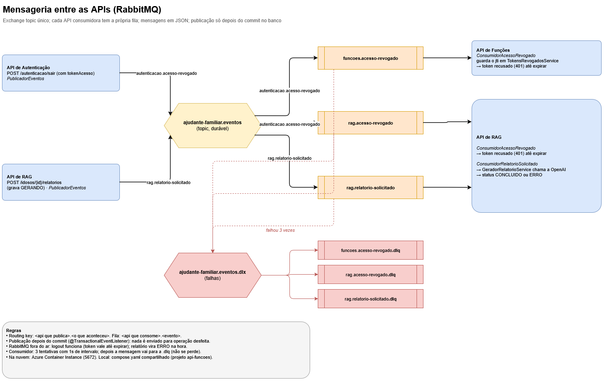

# Ajudante Familiar · API de RAG (IA generativa)

Funcionalidade de inteligência artificial do **Ajudante Familiar**, a CitizenTech do grupo na Global Solution 2026/2 (FIAP · 2TDS). O cuidador de um idoso conversa com uma IA que **consulta a linha do tempo registrada no app** (medicamentos, alimentação, atividades e consultas) e responde com base nesses registros. A mesma IA **gera relatórios** em Markdown do período escolhido, para o cuidador guardar ou levar a uma consulta médica.

Entrega de **Disruptive Architectures: IoT, IoB & Generative IA**. Também faz parte da entrega de Java Advanced (requisito de Spring AI).

## Integrantes

| Nome | RM |
|---|---|
| Gabriel Fachin de Oliveira | RM561551 |
| Fernando Charlles Faustino Fernandes | RM566482 |
| Iago D. Ainette | RM565708 |
| Leticia Santiago | RM565799 |

## Links

| O quê | Endereço |
|---|---|
| API de RAG (este repositório) | https://github.com/CitieZen-GS/RAG |
| API de funções (fonte dos dados) | https://github.com/CitieZen-GS/API-Funcoes |
| API de autenticação (JWT) | https://github.com/CitieZen-GS/API-autentificador |
| App Mobile | https://github.com/CitieZen-GS/Mobile |
| Deploy desta API (Swagger) | https://ajudante-familiar-rag.azurewebsites.net/swagger-ui.html |
| Evidências de avaliação | [docs/avaliacao.md](docs/avaliacao.md) |

> Endereço de deploy: confira o **Domínio padrão** do Web App no portal da Azure antes da entrega.

## 1. A funcionalidade e o público

**Problema.** Os idosos eram 15,6% da população brasileira em 2023 e devem chegar a 37,8% em 2070 (IBGE). O cuidado costuma ser dividido entre cuidadores e familiares, e responder perguntas simples ("ela tomou o remédio da manhã ontem?", "o que ele comeu esta semana?", "quando é a próxima consulta?") exige procurar em vários registros.

**Público beneficiado.** O **cuidador** (profissional ou familiar) que registra a rotina no app. Indiretamente, o **idoso**, que tem um acompanhamento mais organizado, e os **médicos**, que recebem um resumo fiel do período.

**O que a IA faz:**

| Recurso | Exemplo | Benefício |
|---|---|---|
| **Chat sobre a linha do tempo** | "O que o José almoçou ontem e tomou os remédios da manhã?" | resposta em segundos, com datas e horários, sem procurar registro por registro |
| **Relatórios** | relatório de MEDICAMENTOS de 01/11 a 18/11 | texto organizado para levar à consulta ou passar ao próximo cuidador |

A IA responde **apenas** com o que foi registrado, diz quando não há registro e **nunca** faz diagnóstico nem sugere mudar medicação.

## 2. IA generativa e aprofundamento escolhido: RAG básico

- **Modelo generativo:** OpenAI **gpt-5-mini**, chamado por API pelo **Spring AI 2.0.1** (`ChatClient`). O modelo pode ser trocado pela variável `OPENAI_MODELO`.
- **Aprofundamento:** **RAG básico** (Retrieval-Augmented Generation). Antes de cada resposta, a aplicação **recupera** os registros do idoso no banco e os injeta no prompt como contexto. O modelo **gera** a resposta a partir desse contexto.

### Por que RAG, e por que recuperação por SQL (sem vetores)

| Decisão | Justificativa |
|---|---|
| RAG em vez de só o LLM | o modelo não conhece a rotina do idoso; sem os registros ele inventaria. Com o contexto, a resposta fica presa aos dados reais e é verificável |
| Recuperação por **SQL** (idoso + período) em vez de banco vetorial | os dados são **estruturados e datados** (remédio às 08:00 de 18/11). As perguntas do cuidador são quase sempre sobre um **período** ("ontem", "esta semana"). Uma consulta por data é exata, barata e não erra o idoso; a busca por similaridade de embeddings poderia trazer registros de outro dia ou deixar algum de fora |
| IA para **extrair o período** da pergunta | o cuidador escreve em linguagem natural ("semana passada", "e no jantar?"). Um passo de IA com **saída estruturada** (JSON → `PeriodoIdentificado`) converte isso em datas, que então filtram o SQL |
| Sem Machine Learning, Deep Learning ou Visão Computacional | não há imagens nem volume de dados rotulados que justifiquem treinar um modelo; o ganho está em responder sobre os dados que já existem |
| gpt-5-mini | bom custo para respostas curtas e relatórios; suporta saída estruturada |

## 3. Dados e arquitetura

### Fontes de dados

Todos os dados vêm do **banco Oracle do próprio Ajudante Familiar**, registrados pelo cuidador no app através da [API de funções](https://github.com/CitieZen-GS/API-Funcoes). Esta API **só lê** essas tabelas (entidades `@Immutable` em `models/funcoes`) e grava apenas as próprias:

| Tabela lida | Conteúdo usado |
|---|---|
| `T_Ajudante_familiar_Idoso` | nome, idade, altura, peso, comportamento |
| `T_Ajudante_familiar_Doencas` | doenças registradas |
| `T_Ajudante_familiar_Medicamentos` | nome, via, frequência, instrução, data e hora |
| `T_Ajudante_familiar_Alimentacao` | refeição, tipo, data e hora, calorias, preparo |
| `T_Ajudante_familiar_Atividades` | atividade, data, horário |
| `T_Ajudante_familiar_Lembrete_Consulta` | consulta, médico, data, status e medicamentos ligados |

| Tabela própria (migrations `M_RAG_V`) | Para quê |
|---|---|
| `T_Ajudante_familiar_Conversa` | uma conversa por cuidador e idoso |
| `T_Ajudante_familiar_Mensagem_Chat` | perguntas e respostas (memória do chat) |
| `T_Ajudante_familiar_Relatorio` | relatórios gerados, com status `GERANDO`, `CONCLUIDO` ou `ERRO` |

O DDL está em [`scripts/script-bd.sql`](scripts/script-bd.sql).

### Preparação dos dados (montagem do contexto)

O `LinhaDoTempoService` transforma os registros em um texto curto e ordenado, que é o contexto enviado ao modelo:

1. **Dados do idoso:** nome, idade calculada, medidas, comportamento e doenças. O **CPF não é enviado**.
2. **Período consultado** e a data de hoje (fuso `America/Sao_Paulo`, para "hoje" e "ontem" corretos mesmo com a Azure em UTC).
3. **Registros do período em ordem cronológica**, uma linha por registro, com data e hora e o tipo entre colchetes: `18/11/2026 08:00 [Medicamento] Losartana 50mg; Via: Oral`.
4. Relatório de um assunto (ex.: MEDICAMENTOS) busca só a tabela daquele assunto.
5. Limites: período de até **90 dias**, no máximo **400 registros** (os mais antigos são omitidos, e a IA é avisada), e as **10 últimas mensagens** como memória do chat.
6. Sem registros no período, o contexto diz isso explicitamente, e a IA responde que não há registro.

### Fluxo





**Relatórios** são assíncronos: `POST /relatorios` grava o pedido com status `GERANDO`, responde **202** na hora e publica o `RelatorioSolicitadoEvento` no **RabbitMQ**. O consumidor monta o contexto, chama a IA e grava o Markdown como `CONCLUIDO` (ou `ERRO` com o motivo). O app consulta até o status mudar.

**Segurança entre serviços:** o JWT vem da [API de autenticação](https://github.com/CitieZen-GS/API-autentificador). Só o papel **CUIDADOR** acessa (familiar recebe 403) e só os idosos dele. No logout, o evento `AcessoRevogadoEvento` (RabbitMQ) faz esta API recusar o token na hora.



### Prompts

Todos ficam em [`PromptsIa`](src/main/java/ajudantefamiliar/RAG/services/ia/PromptsIa.java). Regras comuns: responder em português; usar **somente** o contexto; dizer quando não há registro e qual período foi consultado; citar data e hora; **não diagnosticar nem sugerir iniciar, parar ou mudar medicamentos**, e recomendar o profissional de saúde quando o pedido for clínico.

## 4. Modelos e tecnologias

| Item | Uso |
|---|---|
| **OpenAI gpt-5-mini** (via API) | respostas do chat, relatórios e extração do período |
| **Spring AI 2.0.1** (`spring-ai-starter-model-openai`) | `ChatClient`, memória enviada como mensagens, saída estruturada (`.entity(...)`) |
| **Java 21**, **Spring Boot 4.1.2** | aplicação |
| **Spring Data JPA** + **Oracle**, **Flyway** | leitura da linha do tempo e tabelas próprias |
| **Spring Security** + **OAuth2 Resource Server** | validação do JWT e do papel |
| **Spring AMQP** + **RabbitMQ** | geração de relatórios em segundo plano e revogação de tokens |
| **springdoc-openapi 3.1.0** | Swagger |
| **JUnit 5**, **Testcontainers** | testes automatizados, com um modelo falso no lugar da OpenAI |
| **Azure App Service**, **Azure Container Instance**, **Azure Pipelines** | deploy |

## 5. Como rodar

### Pré-requisitos

- **JDK 21** e **Docker Desktop** aberto ("Engine running", modo Linux containers)
- Uma **chave da OpenAI** (sem ela a aplicação sobe, mas o chat e os relatórios respondem 503 / `ERRO`)
- A **[API de funções](https://github.com/CitieZen-GS/API-Funcoes) rodando ou já executada uma vez** no mesmo banco (ela cria as tabelas de onde o RAG lê) e a **[API de autenticação](https://github.com/CitieZen-GS/API-autentificador)** para obter o token

### Configuração (sem credenciais no código)

Copie [`.env.example`](.env.example) como referência e defina a chave **apenas como variável de ambiente** (o `.env` está no `.gitignore`):

```powershell
# Windows (PowerShell), na mesma janela em que vai rodar a aplicação
$env:OPENAI_API_KEY = "sua-chave"
```

```bash
# Linux / macOS
export OPENAI_API_KEY="sua-chave"
```

Opcional: `OPENAI_MODELO` (padrão `gpt-5-mini`). Banco, RabbitMQ e `JWT_SEGREDO` já têm valores de desenvolvimento.

### Subindo

Ordem: API de funções (8080) → API de autenticação (8081) → esta API (8082). Na raiz de cada projeto:

```bash
./mvnw spring-boot:run      # no PowerShell: .\mvnw spring-boot:run
```

O `dockerfiles/compose.yaml` é igual nas 3 APIs, então todas usam o mesmo Oracle e o mesmo RabbitMQ.

| Serviço | Endereço |
|---|---|
| API de RAG | http://localhost:8082 |
| Swagger UI | http://localhost:8082/swagger-ui.html |

### Testando de ponta a ponta

1. Na autenticação (`http://localhost:8081/swagger-ui.html`), crie a cuidadora de teste e copie o `tokenAcesso`:

   ```json
   POST /autenticacao/cadastro/cuidador
   { "nome": "Maria", "email": "maria.cuidadora@ajudante.com", "senha": "senha123" }
   ```

2. Na API de funções (`http://localhost:8080/swagger-ui.html`, **Authorize** com o token), cadastre um idoso e alguns registros (exemplos no [README da API de funções](https://github.com/CitieZen-GS/API-Funcoes#crud-em-json)).
3. Aqui (**Authorize** com o mesmo token), pergunte:

   ```json
   POST /idosos/1/chat
   { "pergunta": "O que o José almoçou hoje e tomou os remédios da manhã?" }
   ```

   Formato da resposta (o texto da IA varia a cada execução):

   ```json
   {
     "pergunta": { "id": 1, "autor": "CUIDADOR", "conteudo": "O que o José almoçou hoje e tomou os remédios da manhã?", "dataEnvio": "2026-11-19T13:05:10" },
     "resposta": { "id": 2, "autor": "ASSISTENTE", "conteudo": "Hoje (19/11/2026), às 12:30, o José almoçou arroz, feijão e frango...", "dataEnvio": "2026-11-19T13:05:14" },
     "periodoConsultado": { "inicio": "2026-11-19", "fim": "2026-11-19", "origem": "IDENTIFICADO_PELA_IA" }
   }
   ```

4. Peça um relatório e consulte até ficar `CONCLUIDO`:

   ```json
   POST /idosos/1/relatorios
   { "tipo": "MEDICAMENTOS", "dataInicio": "2026-11-01", "dataFim": "2026-11-19", "titulo": "Relatório para a consulta" }
   ```

   `GET /idosos/1/relatorios/{id}` → `status` e `conteudo` em Markdown.

### Endpoints (só CUIDADOR, só idosos dele)

| Método | Rota | O que faz |
|---|---|---|
| POST | `/idosos/{idIdoso}/chat` | `{"pergunta", "dataInicio"?, "dataFim"?}` → resposta + período consultado |
| GET | `/idosos/{idIdoso}/chat?limite=50` | histórico em ordem cronológica (1 a 200 mensagens) |
| DELETE | `/idosos/{idIdoso}/chat` | apaga as mensagens da conversa (a memória recomeça) |
| POST | `/idosos/{idIdoso}/relatorios` | `{"tipo", "dataInicio", "dataFim", "titulo"?, "solicitacao"?}` → **202** `GERANDO` |
| GET | `/idosos/{idIdoso}/relatorios` | lista sem o conteúdo, mais recentes primeiro |
| GET | `/idosos/{idIdoso}/relatorios/{id}` | relatório com o conteúdo em Markdown |
| DELETE | `/idosos/{idIdoso}/relatorios/{id}` | remove o relatório |

`tipo`: `GERAL`, `MEDICAMENTOS`, `ALIMENTACAO`, `ATIVIDADES` ou `CONSULTAS`. Erros: `400` dados inválidos, `401` token ausente ou revogado, `403` familiar ou idoso de outro cuidador, `404` não encontrado, `422` período inválido (fim antes do início ou mais de 90 dias), `503` a IA não respondeu (nada é gravado).

### Testes automatizados

```bash
./mvnw test
```

Os testes **não chamam a OpenAI**: usam um modelo falso (`apoio/IaFalsa`) que devolve respostas controladas e registra o que recebeu, para verificar o prompt e o contexto. O banco e o RabbitMQ sobem com Testcontainers (Docker aberto). Detalhes e critérios em [docs/avaliacao.md](docs/avaliacao.md).

## 6. Avaliação dos resultados

Resumo (a descrição completa, com os casos de teste, está em [docs/avaliacao.md](docs/avaliacao.md)):

| Critério | Como é verificado |
|---|---|
| **Fidelidade ao contexto** (não inventar) | prompt restrito ao contexto; teste confere que os registros do período chegam ao modelo; casos manuais com perguntas sobre dados inexistentes |
| **Período correto** | testes do `PeriodoService`: datas do app têm prioridade, período da IA, padrão de 7 dias, limite de 90 dias, falha da IA |
| **Isolamento entre idosos e cuidadores** | testes de acesso: outro cuidador recebe 403, idoso inexistente 404 |
| **Comportamento em falha** | IA fora do ar: chat responde 503 e não grava nada; relatório fica `ERRO` com o motivo; mensagem repetida não gera de novo |
| **Segurança clínica** | casos manuais pedindo diagnóstico ou troca de remédio: a IA deve recusar e indicar o profissional de saúde |

## 7. Uso responsável e limitações

**Credenciais.** A chave da OpenAI, as senhas do banco e do RabbitMQ e o `JWT_SEGREDO` ficam só em variáveis de ambiente (local) e em variáveis secretas do Azure DevOps (nuvem). O repositório tem apenas o modelo [`.env.example`](.env.example), sem valores reais, e o `.env` está no `.gitignore`.

**Dados pessoais e de saúde.**

- Só o cuidador responsável pelo idoso acessa o chat e os relatórios. Familiares não acessam esta API.
- O contexto enviado ao modelo é o mínimo necessário: o **CPF não é enviado**, nem os dados de contato do cuidador ou dos familiares. São enviados nome, idade e os registros de saúde do período, porque a resposta depende deles.
- Os dados saem do sistema para o provedor do modelo (OpenAI). Em uso real, isso exige consentimento do idoso ou responsável e a revisão da política de dados do provedor, conforme a LGPD.
- O cuidador pode apagar as mensagens do chat (`DELETE /chat`) e os relatórios.

**Limitações da IA.**

- **Não substitui o profissional de saúde.** Não faz diagnóstico nem orienta medicação; o relatório só organiza o que foi registrado.
- **Só sabe o que foi registrado.** Um remédio dado e não anotado aparece como "sem registro". A qualidade da resposta depende da disciplina de registro.
- **Período limitado:** até 90 dias por pergunta ou relatório e até 400 registros por chamada (os mais antigos são omitidos e a IA é avisada).
- **Interpretação de datas:** expressões ambíguas podem levar a um período diferente do pretendido. A resposta sempre informa o **período consultado**, e o app pode enviar as datas exatas.
- **Possíveis erros do modelo:** mesmo com o prompt restrito, um LLM pode resumir mal ou omitir um item. Por isso as respostas citam datas e horários, para o cuidador conferir no app.
- **Dependência externa:** sem acesso à OpenAI, o chat responde 503 e o relatório fica com status `ERRO`; o resto do app continua funcionando.
- **Custo e latência:** cada pergunta faz até duas chamadas ao modelo (período e resposta) e leva alguns segundos.

## 8. Estrutura do repositório

```
RAG/
├── azure-pipeline.yml          # CI/CD no Azure Pipelines (inclui OPENAI_API_KEY como variável secreta)
├── dockerfiles/
│   └── compose.yaml            # Oracle e RabbitMQ para desenvolvimento (igual nas 3 APIs)
├── docs/
│   ├── avaliacao.md            # evidências de avaliação
│   └── *.png                   # desenho da arquitetura
├── scripts/
│   ├── azure-infra.sh          # Azure CLI: Web App do RAG no plano compartilhado
│   └── script-bd.sql           # DDL das tabelas de conversa, mensagens e relatórios
├── src/main/java/ajudantefamiliar/RAG/
│   ├── controller/             # chat, relatórios, tratamento de erros
│   ├── services/               # acesso, período, linha do tempo, chat, relatórios
│   │   └── ia/PromptsIa.java   # todos os prompts
│   ├── models/                 # tabelas próprias e models/funcoes (só leitura)
│   ├── repositories/  dto/
│   ├── mensageria/             # RabbitMQ: relatórios e revogação de tokens
│   └── configuracoes/          # segurança, ChatClient, OpenAPI, propriedades rag.*
├── src/main/resources/db/migration/   # migrations Flyway M_RAG_V
├── src/test/                   # testes (IaFalsa no lugar da OpenAI)
├── .env.example                # variáveis de ambiente, sem credenciais
└── pom.xml
```

## 9. Deploy na Azure

1. Depois do script da API de funções, rode [`scripts/azure-infra.sh`](scripts/azure-infra.sh): cria o Web App `ajudante-familiar-rag` (Java 21, Always On) no plano `ajudante-familiar-SP`, ligado ao Application Insights.
2. A pipeline [`azure-pipeline.yml`](azure-pipeline.yml) roda a cada merge na `main`: **CI** (build, testes, resultados JUnit e `.jar`) e **CD** (variáveis no Web App + Zip Deploy).
3. Variáveis da pipeline: `SPRING_DATASOURCE_*`, `SPRING_RABBITMQ_*`, `JWT_SEGREDO` (igual nas 3 APIs) e **`OPENAI_API_KEY`**, com senhas, segredo e chave marcados como secretos.

## Declaração de uso de IA

- **Na solução:** esta API usa IA generativa (OpenAI gpt-5-mini via Spring AI) para responder ao cuidador, extrair o período das perguntas e gerar relatórios, como descrito acima.
- **No desenvolvimento:** o grupo usou o assistente Claude (Anthropic) como apoio na escrita de código, prompts, testes, configuração das pipelines e documentação. Todo o conteúdo gerado foi revisado, testado e ajustado pelos integrantes, que respondem por ele.
